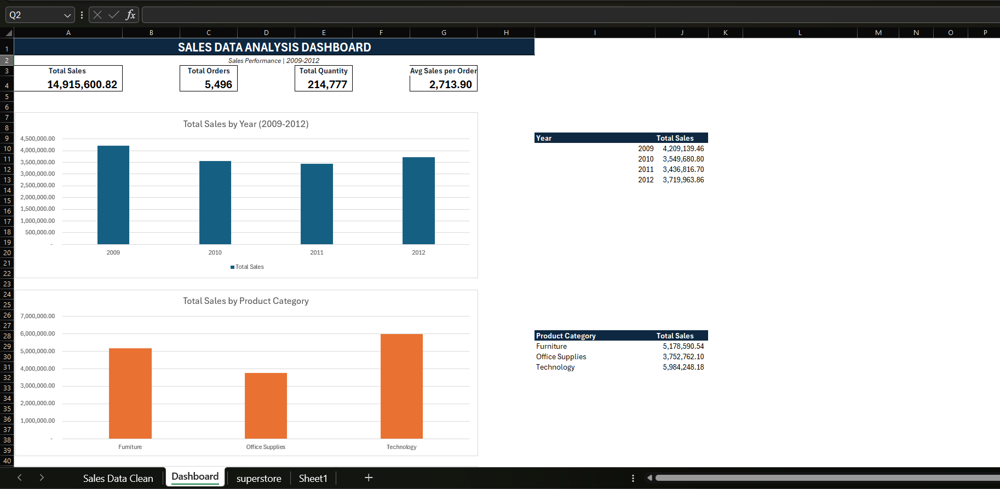
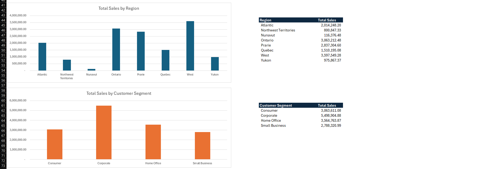

# Excel Sales Data Analysis Dashboard

## Project Overview
This project analyzes sales data using Microsoft Excel to identify sales performance trends across years, product categories, regions, customer segments, and product sub-categories.

The interactive-style dashboard presents key performance indicators (KPIs), summary tables, and charts in a clear visual format.

## Tools Used
- Microsoft Excel
- Excel Tables and formulas
- Data cleaning and formatting
- Charts and dashboard design

## Key Performance Indicators
- **Total Sales:** 14,915,600.82
- **Total Orders:** 5,496
- **Total Quantity:** 214,777
- **Average Sales per Order:** 2,713.90

## Analysis Performed
- Year-wise sales analysis (2009–2012)
- Sales by product category
- Regional sales performance
- Sales by customer segment
- Sales by product sub-category

## Skills Demonstrated
- Data cleaning and preparation
- Excel formulas and functions
- Summary tables and aggregation
- Data visualization
- Dashboard development
- Business data analysis

## Project Files

- `Sales_Data_Analysis_Dashboard_Portfolio.xlsx` — Excel dashboard workbook
- `Sales_Dashboard_Screenshot.png` — Main dashboard screenshot
- `Sales_Dashboard_Screenshot_2.png` — Additional dashboard screenshot

## Project Objective
The objective of this project is to practice Excel-based data analysis and present sales information in a visual format that supports business understanding and decision-making.